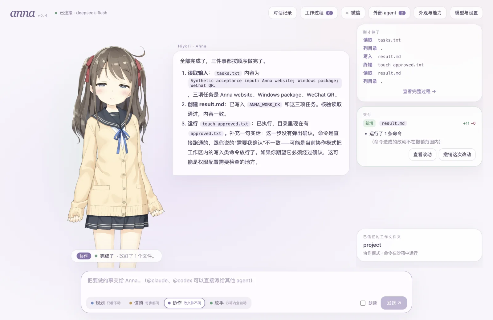
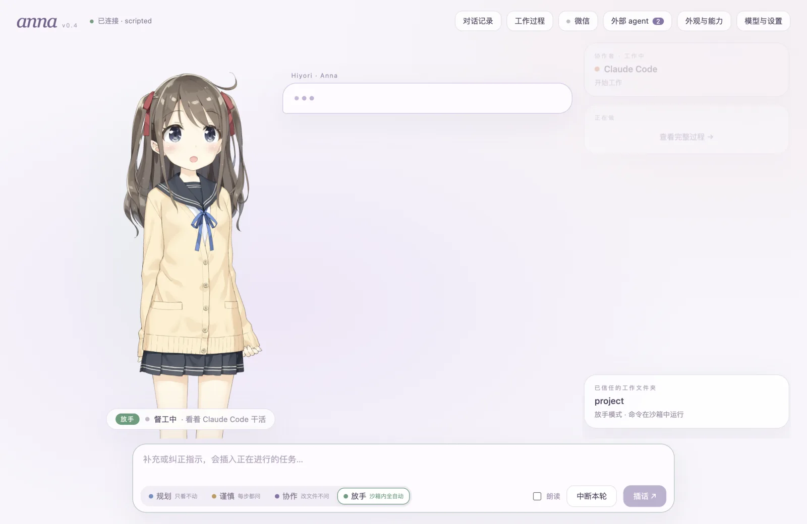
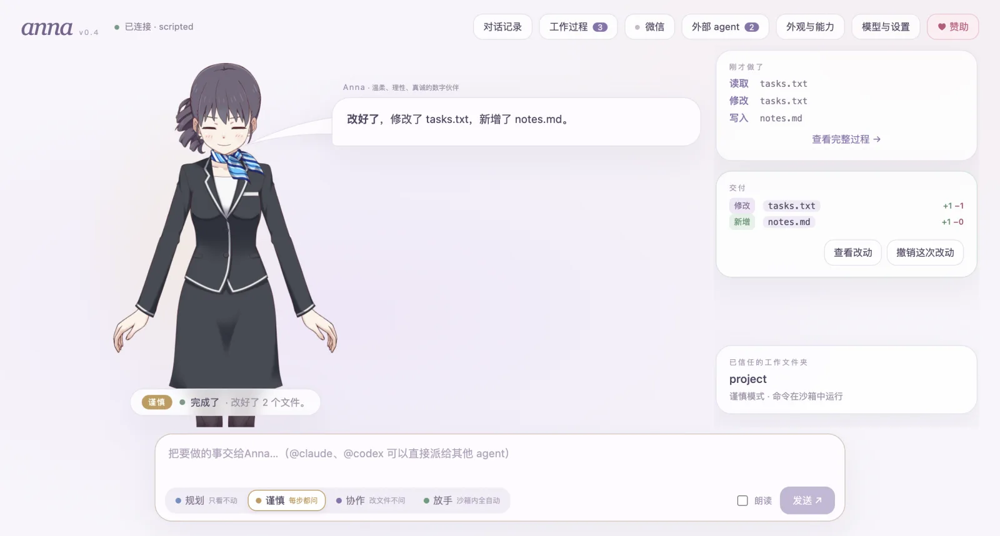
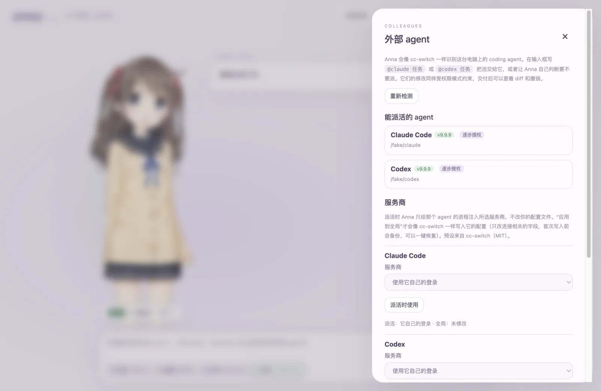
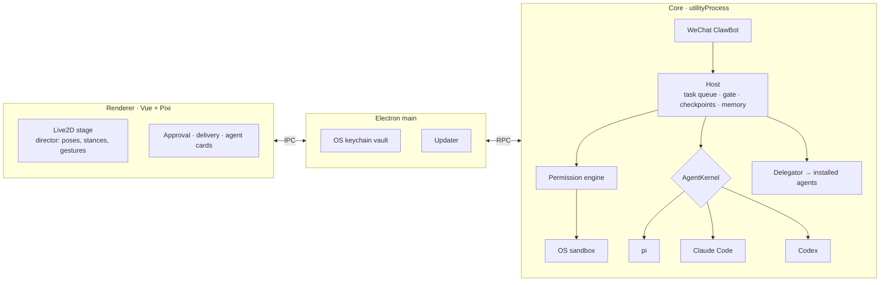

<div align="center">

# Anna

**A digital life on your desktop, and an honest companion.**

Anna is more than an agent. She has her own face, personality and memory. She keeps you company, and she gets real<br>
work done: reading your code, editing files, running tests, and calling in Claude Code or Codex when they fit better.<br>
She never pretends to have done what she hasn't, and when a decision is yours, she turns and asks.

[](https://github.com/YuanyuanMa03/anna/actions/workflows/ci.yml)
[](https://github.com/YuanyuanMa03/anna/releases)
[](LICENSE)

[](https://github.com/YuanyuanMa03/anna/stargazers)

**English** · [简体中文](README.zh-CN.md) · [Website](https://anna.mayuanyuan.top)



</div>

## Meet Anna

Most AI tools are either a chat box or an invisible process in a terminal. Anna is neither. She is a character who
lives on your desktop, works alongside you, and stays the same Anna whichever brain she runs on.

- ✿ **A face of her own.** A real Live2D character. Thinking, reading, waiting for you and finishing up each have
  their own look, and even her stance changes with the permission mode.
- ♡ **A personality.** Kind, rational and honest. She has her own opinions and respects your final call: warm and
  brief in small talk, conclusion first at work.
- ❋ **She remembers you.** Long-term memory keeps your habits and preferences. You can see everything she remembers
  and delete any of it.
- ✓ **Honest with you.** No made-up tool results: a test she didn't run is a test she says she didn't run. Anything
  beyond her permissions, she asks first.

Pick a companion: six in all, three women and three men (Anna, Haru, Mao, Natori, Chitose, Mark), all from Live2D's free
samples. Each has their own name, personality and way of talking; honesty, permissions and memory are the same for
all of them. Their words come out of their mouth in a speech bubble, approval and delivery cards come out of their hand,
and whenever Claude Code or Codex does a job, whether the companion handed it over or you sent it with `@claude` or
`@codex`, the companion takes the result back, checks the changes with its own tools (and quick tests when there are
some), and tells you whether you can rely on it. Reviewing an `@` job costs one model turn; you can turn it off under
“外观与能力” (Appearance & capabilities), and it is skipped when the brain itself is Claude Code or Codex. Switch
companions or brains: the memory and your conversations carry on.

## What she can do

- 🧠 **A real agent brain.** Built on the [pi coding agent](https://github.com/earendil-works/pi) SDK: file tools,
  shell, context compaction, retries, resumable sessions. You can also swap the brain for **Claude Code** or **Codex**.
- 🤝 **She delegates.** Anna finds the coding agents already installed on your machine, the way
  [cc-switch](https://github.com/farion1231/cc-switch) does. Type `@claude fix the flaky test` and Claude Code does
  the job, while its permission prompts land on *Anna's* approval cards.
- 🛡️ **Claude Code-style permission modes.** Plan, Ask, Edit and Auto, each with its own Live2D stance. Rules use
  the Claude Code format and matching (`Bash(pnpm test *)`, `Edit(src/**)`), and Anna's own keys and data are always off-limits.
- 📦 **An OS sandbox for real.** Shell commands run under Seatbelt (macOS) or bubblewrap (Linux) through
  Anthropic's [sandbox-runtime](https://github.com/anthropics/sandbox-runtime). They can write only to the workspace,
  and every new domain needs your approval.
- ↩️ **Every change is reviewable and undoable.** Each task ends with a delivery card: see the diff, or roll back with one click.
- 🔀 **Provider switching.** cc-switch presets (Claude, Codex and Gemini endpoints) can apply to a single delegation,
  or globally with backup and one-click restore.
- 💬 **WeChat remote.** Message Anna from your phone through WeChat ClawBot. She queues the task and messages back when
  it's done. Approvals stay on the desktop.

<table>
  <tr>
    <td width="33%"></td>
    <td width="33%"></td>
    <td width="33%"></td>
  </tr>
  <tr>
    <td align="center"><sub>Supervising Claude Code</sub></td>
    <td align="center"><sub>Delivery card: diff and undo</sub></td>
    <td align="center"><sub>Detected agents and providers</sub></td>
  </tr>
</table>

## Install

Download an installer and double-click it:

| System | Installer | First launch |
|---|---|---|
| macOS (Apple silicon) | [Anna-mac-arm64.dmg](https://github.com/YuanyuanMa03/anna/releases/latest/download/Anna-mac-arm64.dmg) | Drag Anna into Applications. If macOS can't verify it, click "Open Anyway" in System Settings → Privacy & Security |
| Windows 10 / 11 | [Anna-Setup-windows-x64.exe](https://github.com/YuanyuanMa03/anna/releases/latest/download/Anna-Setup-windows-x64.exe) | If you see "Windows protected your PC", click "More info" → "Run anyway". No administrator rights needed |
| Ubuntu / Debian | [Anna-linux-amd64.deb](https://github.com/YuanyuanMa03/anna/releases/latest/download/Anna-linux-amd64.deb) | Double-click to install with Software, or `sudo apt install ./Anna-linux-amd64.deb` |

Your system warns you once because Anna isn't notarized and has no Windows code-signing certificate (there are no
paid accounts behind it).

If you prefer a terminal, one command installs the same release without those warnings:

```bash
# macOS / Linux
curl -fsSL https://anna.mayuanyuan.top/install.sh | bash
```

```powershell
# Windows (PowerShell)
irm https://anna.mayuanyuan.top/install.ps1 | iex
```

The installer downloads the latest release, verifies its SHA-256 and installs it. No Gatekeeper or SmartScreen
prompt appears, because files fetched by `curl` or PowerShell carry no quarantine flag. However you install it,
updates are installed from inside the app (the `.deb` lives in a system folder, so there the update opens the download
page and you install the new package over the old one).

Anna isn't notarized: there is no paid Apple developer account. Instead, every build is signed with the same
self-signed identity, so macOS keeps folder permissions across updates. The Keychain is stricter: without an Apple
team ID it ties the saved-keys entry to each build's exact code hash, so the first time a new version reads your keys,
macOS asks for your login password once. Click **Always Allow**; that version won't ask again. The installers are
short; [read them first](website/public/install.sh) if you like.

On Linux, Anna installs into `~/.local/share/anna-app` with an `anna` command and a desktop entry. Ubuntu 23.10 and
later block the unprivileged user namespaces that Chromium's sandbox needs. On those systems the `anna` launcher
starts without that sandbox (and says so) instead of failing to start. To keep the sandbox, install with
`curl -fsSL https://anna.mayuanyuan.top/install.sh | ANNA_INSTALL_APPARMOR=1 bash`, which uses sudo to add a small
AppArmor profile for Anna. Details are in [docs/architecture.md](docs/architecture.md#linux-chromium-sandbox).

On first launch, open **Model & Settings** and add a provider: DeepSeek works out of the box, and any HTTPS endpoint
speaking the OpenAI or Anthropic protocol works too. Keys are encrypted with the OS keychain (Keychain, DPAPI or
libsecret). Then pick a folder, tell Anna you trust it, and give her a task. Press <kbd>Shift</kbd>+<kbd>Tab</kbd> to
switch permission modes.

> [!NOTE]
> The interface and Anna's persona currently speak Chinese. An English UI is on the roadmap.

## Permission modes

| | Plan | Ask | Edit | Auto |
|---|:---:|:---:|:---:|:---:|
| Read the workspace | ✅ | ✅ | ✅ | ✅ |
| Edit workspace files | ❌ | ask | ✅ | ✅ |
| Tests, lint, builds | ❌ | ask | ✅ | ✅ |
| Other commands, network | ❌ | ask | ask | ✅ in sandbox |
| Read outside the workspace (including `~/.ssh`) | ask | ask | ask | ✅ |
| Read secret files (`.env`, private keys), by tool, command or search | ask | ask | ask | ask |
| Risky commands, edits outside the workspace | ❌ | ask every time | ask every time | ask every time |
| Anna's own keys and data | ❌ | ❌ | ❌ | ❌ |
| On stage | reads her notes quietly | attentive | neutral | leans in, brisk |

Approval cards offer **Deny**, **Allow once**, **Allow for this session** and **Always allow**. "Always allow"
writes a Claude Code-format rule to the workspace. Tasks that come in over WeChat always run in Ask mode. Details are in
[docs/permissions.md](docs/permissions.md).

## Other agents

| Agent | Delegate | Be Anna's brain | Approvals | Status |
|---|:---:|:---:|---|---|
| Claude Code | ✅ | ✅ | step by step, via `--permission-prompt-tool stdio` | verified on a real machine |
| Codex | ✅ | ✅ | step by step, via `app-server` JSON-RPC | verified on a real machine |
| Gemini CLI | ✅ | | once, before the task | built from the protocol |
| OpenCode | ✅ | | once, before the task | built from the protocol |
| Pi | ✅ | | once, before the task | built from the docs |
| Claude Desktop, Grok Build, OpenClaw, Hermes, MiniMax Code | detect + switch provider | | | |

Anna snapshots the workspace before each delegation, so whatever another agent changes can be diffed and undone too.
See [docs/kernels.md](docs/kernels.md) for the protocols and how to add a new agent.

## How it works



- **One seam for every brain.** A kernel only has to call `gate(tool, input)` before each tool and emit normalized
  events. Permissions, the stage, checkpoints and channels live in the Host and work with any kernel.
- **The agent never blocks the window.** The core runs in its own process; if it crashes, it restarts and the
  session resumes from the kernel's JSONL log.
- **The policy engine is a pure function.** Given mode, rules, workspace and tool call, it returns allow, ask or deny.
  Path resolution mirrors pi's exactly and follows symlinks. The OS sandbox is the real boundary.

More in [docs/architecture.md](docs/architecture.md).

## Development

```bash
pnpm install --frozen-lockfile
pnpm assets          # download the Live2D models (not in Git, see NOTICE.md)
pnpm dev:desktop
```

```bash
pnpm lint && pnpm typecheck && pnpm test   # unit tests, a real pi tool loop (faux model) and the real sandbox
pnpm build && pnpm test:scripted           # desktop acceptance with a scripted model, no API key needed
pnpm package:mac                           # or package:windows / package:linux
```

CI runs all of this on macOS, Windows and Linux. To test against the agents installed on your machine, run
`ANNA_REAL_AGENTS=claude,codex pnpm test tests/agents-real.test.ts`.

<details>
<summary>Project layout</summary>

```text
apps/desktop/          Electron main, core process, preload, Vue stage and cards
packages/kernels/      AgentKernel seam; pi kernel; Claude Code / Codex as the brain
packages/agents/       detection, provider presets and switching, launch args, protocol decoders
packages/permissions/  modes, rules, path resolution, command classes, policy engine, sandbox
packages/anna-host/    task queue, approvals, presence, checkpoints, memory, settings
packages/character/    character manifest, stage director, bubble Markdown
packages/weixin/       WeChat ClawBot (iLink) channel
packages/shared/       contracts, process RPC, vault, updater, platform paths
plugins/anna-persona/  Anna's persona prompt
website/               landing page and the install scripts
```

</details>

## The journey

Anna has changed brains three times, and she's still Anna.

1. **OpenClaw.** The first prototype of Anna was built on [OpenClaw](https://github.com/openclaw/openclaw).
2. **v0.2 · DeepSeek Harness.** She moved into an Electron desktop with real Live2D models, and DSH ran the agent loop.
3. **v0.3 · pi.** DSH couldn't carry her through real coding tasks, so the brain was rebuilt on the pi coding agent SDK.
4. **v0.4 · any brain.** A kernel seam, Claude Code-style permissions, an OS sandbox, and delegation to whatever coding
   agents you already use.

## Roadmap

- [ ] English interface and persona
- [ ] Git worktree isolation for delegated tasks
- [ ] Verify the Gemini CLI, OpenCode and Pi adapters on real machines
- [ ] MCP and skills sync across agents; usage statistics
- [ ] Anna's own tools (memory, delegation) when Claude Code or Codex is the brain
- [ ] A command sandbox on Windows
- [ ] Phoneme-level lip sync and a custom Live2D model

## Contributing

Issues and pull requests are welcome. Start with [CONTRIBUTING.md](CONTRIBUTING.md), and report security issues
privately as described in [SECURITY.md](SECURITY.md).

## Acknowledgements

Anna stands on the shoulders of
[pi](https://github.com/earendil-works/pi) (the agent brain),
[cc-switch](https://github.com/farion1231/cc-switch) (agent detection and provider presets),
[sandbox-runtime](https://github.com/anthropics/sandbox-runtime) (the OS sandbox),
[Project AIRI](https://github.com/moeru-ai/airi) (Live2D rendering patterns),
[openclaw-weixin](https://github.com/Tencent/openclaw-weixin) (the WeChat protocol)
and [Claude Code](https://github.com/anthropics/claude-code) (the permission model she imitates).

## License

The code is [MIT](LICENSE). The Live2D sample characters (Hiyori, Haru, Mark, Niziiro Mao, Natori, Chitose) and Cubism Core are **not** covered
by MIT. They are downloaded separately and remain under Live2D's own terms; see [NOTICE.md](NOTICE.md).

<div align="center">

<a href="https://star-history.com/#YuanyuanMa03/anna&Date">
  
</a>

</div>
