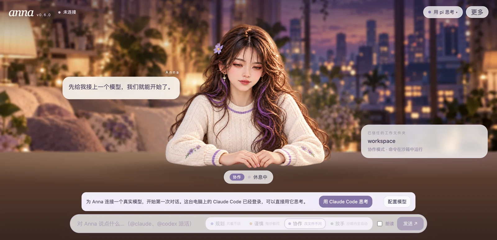
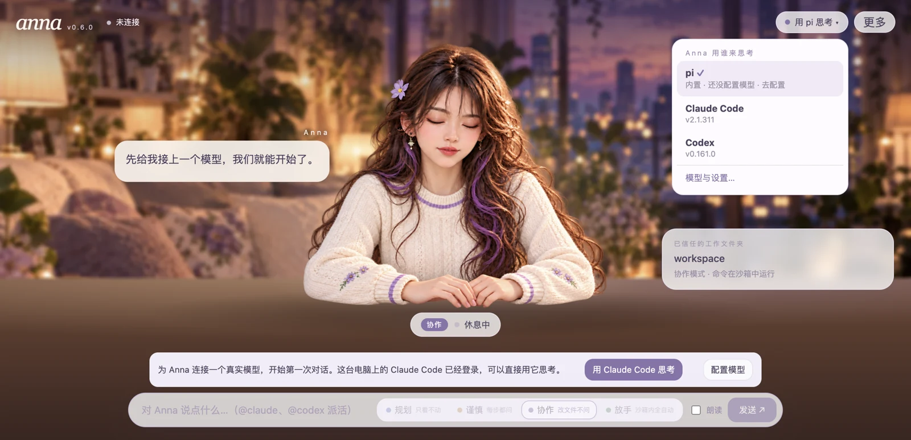
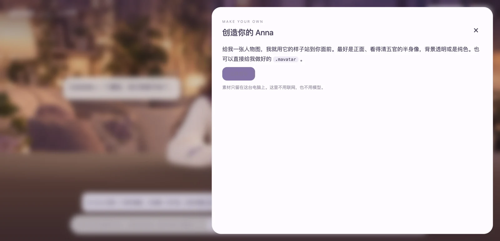
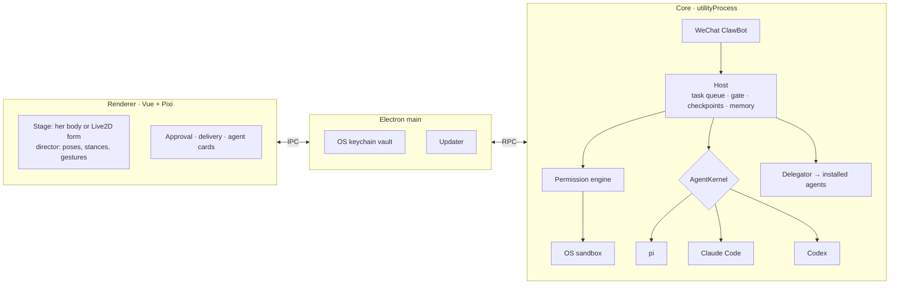

<div align="center">

# Anna

**She wakes on your desktop.**

She keeps you company, does the work, and never lies to you.<br>
A character with a face, a heart and a memory of her own, who reads your code, edits files, runs tests,<br>
and calls in Claude Code or Codex when they fit better. When a decision is yours, she turns and asks.

[](https://github.com/YuanyuanMa03/anna/actions/workflows/ci.yml)
[](https://github.com/YuanyuanMa03/anna/releases)
[](LICENSE)

[](https://github.com/YuanyuanMa03/anna/stargazers)

**English** · [简体中文](README.zh-CN.md) · [Website](https://anna.mayuanyuan.top) · [Try it online](https://modelscope.cn/studios/mayy101184/anna)



</div>

## What’s new in v0.6.0

Anna now has her own body and room. Create your own Anna from a portrait or a `.mavatar` file while keeping her personality and memory. This release also adds a brain picker and experimental ACP kernel support (off by default), and fixes version display and memory attribution.

**Updating from v0.5.1 or earlier:** install v0.6.0 manually once. The release signing key was replaced; older versions cannot verify updates signed by the new key. Folder and Keychain access may need to be authorized again.

## Meet Anna

Most AI tools are either a chat box or an invisible process in a terminal. Anna is neither. She is a character who
lives on your desktop, works alongside you, and stays the same Anna whichever brain she runs on.

- ✿ **A face of her own.** Her own body, drawn from her original art: she looks at you, looks down while you type and
  blushes when you pat her head. Thinking, reading, waiting for you and finishing up each have their own look, and even
  her stance changes with the permission mode.
- ♡ **A personality.** Kind, rational and honest. She has her own opinions and respects your final call: warm and
  brief in small talk, conclusion first at work.
- ❋ **She remembers you.** Long-term memory keeps your habits and preferences. You can see everything she remembers
  and delete any of it.
- ✓ **Honest with you.** No made-up tool results: a test she didn't run is a test she says she didn't run. Anything
  beyond her permissions, she asks first.

She has two forms, her own body and a Live2D anime form, and you switch between them under “外观与能力” (Appearance &
capabilities). You can also make her your own: under 更多 → 创造我的 Anna, give her a picture and five clicks, or a finished
`.mavatar`, and she takes that look. Her personality and memory stay the same.

Quick creation runs locally without a model or network. The result breathes, turns, blinks and speaks, with simpler expressions and no flowing hair. A vision-capable brain can refine it using the full tools, usually over tens of minutes.

Her words float beside her face and fade, approval and delivery cards come out of her hand, and whenever Claude Code or
Codex does a job, whether she handed it over or you sent it with `@claude` or `@codex`, she takes the result back, checks
the changes with her own tools (and quick tests when there are some), and tells you whether you can rely on it. Reviewing
an `@` job costs one model turn; you can turn it off under “外观与能力”, and it is skipped when the brain itself is Claude
Code or Codex. Her diary about you (long-term memory) and her work log stay with her when she changes brains. When she
brings up something another agent did, she says whose it was instead of taking credit.

## What she can do

- 🧠 **A real agent brain.** Built on the [pi coding agent](https://github.com/earendil-works/pi) SDK: file tools,
  shell, context compaction, retries, resumable sessions. You can also swap the brain for **Claude Code** or **Codex**;
  the shared diary, status and delegation tools come along over a local MCP server.
- 🤝 **She delegates.** Anna finds the coding agents already installed on your machine, the way
  [cc-switch](https://github.com/farion1231/cc-switch) does. Type `@claude fix the flaky test` and Claude Code does
  the job, while its permission prompts land on *Anna's* approval cards.
- 🛡️ **Claude Code-style permission modes.** Plan, Ask, Edit and Auto, each with its own stance. Rules use
  the Claude Code format and matching (`Bash(pnpm test *)`, `Edit(src/**)`), and Anna's own keys and data are always off-limits.
- 📦 **An OS sandbox for real.** Shell commands run under Seatbelt (macOS) or bubblewrap (Linux) through
  Anthropic's [sandbox-runtime](https://github.com/anthropics/sandbox-runtime). They can write only to the workspace,
  and network approval follows the permission mode. When available, the sandbox also permits temporary folders and package caches. Windows and environments without a sandbox require more command approvals. External Claude Code / Codex processes use their own permission mechanisms.
- ↩️ **Every change is reviewable and undoable.** Each task ends with a delivery card: see the diff, or roll back with one click.
- 🔀 **cc-switch, built in.** A providers tab per agent (Claude Code, Codex, Gemini CLI): 289 presets from cc-switch,
  searchable, or your own; universal providers (one gateway for all three); a speed test across a provider's
  addresses; balances and Coding Plan quotas; import links (cc-switch's format) and export / import. Use a provider
  for delegations and for Claude Code or Codex as Anna's brain, or switch the agent's own config globally with backup
  and one-click restore, from the panel, the tray, or by asking her. Codex gets a model catalog for
  third-party models, and runs on DeepSeek, which speaks its Responses API natively; providers that only speak Chat
  Completions reach Claude Code and Codex through Anna's local routing, which converts the format on this machine and
  keeps the real key to itself. Give Claude Code or Codex backup providers and a failing one is swapped out mid-task,
  with a circuit breaker per provider. Switch on global routing and the Claude Code or Codex you run in a terminal goes
  through Anna too (its config goes back when Anna quits). MCP and skills sync and usage stats come next.
- 💬 **WeChat remote.** Message Anna from your phone through WeChat ClawBot. She queues the task and messages back when
  it's done. Reply `1` or `0` in WeChat for ordinary approvals; high-risk actions still require the desktop.

<table>
  <tr>
    <td width="33%"></td>
    <td width="33%"></td>
    <td width="33%"></td>
  </tr>
  <tr>
    <td align="center"><sub>Choose her brain</sub></td>
    <td align="center"><sub>Create your Anna from a picture</sub></td>
    <td align="center"><sub>External agents and providers</sub></td>
  </tr>
</table>

## Install

> [!TIP]
> Want to meet her before installing? Try the browser edition on
> [ModelScope Studio](https://modelscope.cn/studios/mayy101184/anna), on free models: no install, no API key, and each visitor gets an isolated Linux account, workspace and temporary memory. WeChat, local provider configuration and switching brains require the desktop. The interface reports whether a command sandbox is available. The page is in Chinese, like the app.

<p align="center"></p>

Download an installer and double-click it:

| System | Installer | First launch |
|---|---|---|
| macOS (Apple silicon) | [Anna-mac-arm64.dmg](https://github.com/YuanyuanMa03/anna/releases/latest/download/Anna-mac-arm64.dmg) | Drag Anna into Applications. If macOS can't verify it, click "Open Anyway" in System Settings → Privacy & Security |
| Windows 10 / 11 | [Anna-Setup-windows-x64.exe](https://github.com/YuanyuanMa03/anna/releases/latest/download/Anna-Setup-windows-x64.exe) | If you see "Windows protected your PC", click "More info" → "Run anyway". No administrator rights needed |
| Ubuntu / Debian | [Anna-linux-amd64.deb](https://github.com/YuanyuanMa03/anna/releases/latest/download/Anna-linux-amd64.deb) | Double-click to install with Software, or `sudo apt install ./Anna-linux-amd64.deb` |

Your system warns you once because Anna isn't notarized and has no Windows code-signing certificate (there are no
paid accounts behind it).

If you prefer a terminal, one command installs the same release without those warnings:

```bash
# macOS / Linux
curl -fsSL https://anna.mayuanyuan.top/install.sh | bash
```

```powershell
# Windows (PowerShell)
irm https://anna.mayuanyuan.top/install.ps1 | iex
```

The installer downloads the latest release, verifies its SHA-256 and installs it. No Gatekeeper or SmartScreen
prompt appears, because files fetched by `curl` or PowerShell carry no quarantine flag. However you install it,
updates are installed from inside the app (the `.deb` lives in a system folder, so there the update opens the download
page and you install the new package over the old one).

Anna isn't notarized: there is no paid Apple developer account. Version 0.6.0 uses a rebuilt self-signed identity. Upgrading from an older version may require fresh folder authorization; future permission retention depends on macOS. The Keychain is stricter: without an Apple
team ID it ties the saved-keys entry to each build's exact code hash, so the first time a new version reads your keys,
macOS asks for your login password once. Click **Always Allow**; that version won't ask again. The installers are
short; [read them first](website/public/install.sh) if you like.

On Linux, Anna installs into `~/.local/share/anna-app` with an `anna` command and a desktop entry. Ubuntu 23.10 and
later block the unprivileged user namespaces that Chromium's sandbox needs. On those systems the `anna` launcher
starts without that sandbox (and says so) instead of failing to start. To keep the sandbox, install with
`curl -fsSL https://anna.mayuanyuan.top/install.sh | ANNA_INSTALL_APPARMOR=1 bash`, which uses sudo to add a small
AppArmor profile for Anna. Details are in [docs/architecture.md](docs/architecture.md#linux-chromium-sandbox).

A fresh install has no preconfigured model. Open the top-right brain picker: use an installed, signed-in Claude Code or Codex, or open **Model & Settings** to connect pi to DeepSeek or an HTTPS provider speaking OpenAI or Anthropic protocols. Keys are encrypted with the OS keychain (Keychain, DPAPI or
libsecret). Then pick a folder, tell Anna you trust it, and give her a task. Press <kbd>Shift</kbd>+<kbd>Tab</kbd> to
switch permission modes.

> [!NOTE]
> The interface and Anna's persona currently speak Chinese. An English UI is on the roadmap.

## Permission modes

| | Plan | Ask | Edit | Auto |
|---|:---:|:---:|:---:|:---:|
| Read the workspace | ✅ | ✅ | ✅ | ✅ |
| Edit workspace files | ❌ | ask | ✅ | ✅ |
| Tests, lint, builds | ❌ | ask | ✅ | ✅ |
| Other commands, network | ❌ | ask | ask | ✅ in sandbox |
| Read outside the workspace (including `~/.ssh`) | ask | ask | ask | ✅ |
| Read secret files (`.env`, private keys), by tool, command or search | ask | ask | ask | ask |
| Risky commands, edits outside the workspace | ❌ | ask every time | ask every time | ask every time |
| Anna's own keys and data | ❌ | ❌ | ❌ | ❌ |
| On stage | reads her notes quietly | attentive | neutral | leans in, brisk |

Approval cards offer **Deny**, **Allow once**, **Allow for this session** and **Always allow**. "Always allow"
writes a Claude Code-format rule to the workspace. Tasks that come in over WeChat always run in Ask mode. Details are in
[docs/permissions.md](docs/permissions.md).

## Other agents

| Agent | Delegate | Be Anna's brain | Approvals | Status |
|---|:---:|:---:|---|---|
| Claude Code | ✅ | ✅ | step by step, via `--permission-prompt-tool stdio` | verified on a real machine |
| Codex | ✅ | ✅ | step by step, via `app-server` JSON-RPC | verified on a real machine |
| Gemini CLI | ✅ | experimental ACP | once, before the task; as brain, sandboxed, asked calls via her gate | built from the protocol |
| OpenCode | ✅ | experimental ACP | once, before the task; as brain, sandboxed, asked calls via her gate | built from the protocol |
| Pi | ✅ | | once, before the task | built from the docs |
| Claude Desktop, OpenClaw, Hermes, Oh My Pi, DeepSeek Harness, Antigravity CLI | detect + switch provider | | | |
| Grok Build, MiniMax Code, Kimi Code | detect + switch provider | experimental ACP | sandboxed, asked calls via her gate | built from the protocol |
| Qwen Code, Cursor CLI, GitHub Copilot CLI, Goose, Factory Droid, Auggie, CodeBuddy Code, Qoder CLI, Cline, Kilo | detect | experimental ACP | sandboxed, asked calls via her gate | built from the protocol |

The brain chip in the corner (「用 pi 思考 ▾」) lists every brain on this machine with what stands between it and thinking,
and switches in one click. Someone without a model is offered a signed-in Claude Code or Codex instead.

Agents in the catalog that speak the Agent Client Protocol (ACP) can be her brain too, running inside her sandbox, but this
is off by default: it has only run against protocol fakes, not a real agent. Set `ANNA_ACP=1` to try it (see
[docs/kernels.md](docs/kernels.md#acp-brains)).

Anna snapshots the workspace before each delegation, so whatever another agent changes can be diffed and undone too.
See [docs/kernels.md](docs/kernels.md) for the protocols and how to add a new agent.

## How it works



- **One seam for every brain.** A kernel only has to call `gate(tool, input)` before each tool and emit normalized
  events. Permissions, the stage, checkpoints and channels live in the Host and work with any kernel.
- **The agent never blocks the window.** The core runs in its own process; if it crashes, it restarts and the
  session resumes from the kernel's JSONL log.
- **The policy engine is a pure function.** Given mode, rules, workspace and tool call, it returns allow, ask or deny.
  Path resolution mirrors pi's exactly and follows symlinks. The OS sandbox is the real boundary.

More in [docs/architecture.md](docs/architecture.md).

## Development

The optional [Anna Gateway data entrypoint](docs/gateway-deployment.md) runs separately with native Node.js 24+, without installing Electron or model runtimes. It connects an existing New API backend; the integrated service workbench is still planned. Windows, macOS and Linux use the same commands, with target-platform acceptance tracked separately.

```bash
pnpm install --frozen-lockfile
pnpm assets          # download her Live2D model (not in Git, see NOTICE.md)
pnpm dev:desktop
```

You only need [pnpm](https://pnpm.io/installation), on macOS, Windows or Linux, Intel or ARM. It switches itself to the
pinned 10.33.0 and downloads the pinned Node 24.21.0, the version inside Electron 44, so every machine builds with the same
tools. Her data lives in `~/Library/Application Support/Anna` on macOS, `%APPDATA%\Anna` on Windows and
`$XDG_DATA_HOME/anna` on Linux. A brand-new install has no model chosen: pick a brain from the chip in the corner.

```bash
pnpm lint && pnpm typecheck && pnpm test   # unit tests, a real pi tool loop (faux model) and the real sandbox
pnpm build && pnpm test:scripted           # desktop acceptance with a scripted model, no API key needed
pnpm package:mac                           # or package:windows / package:linux
```

CI runs all of this on macOS, Windows and Linux. To test against the agents installed on your machine, run
`ANNA_REAL_AGENTS=claude,codex pnpm test tests/agents-real.test.ts`.

<details>
<summary>Project layout</summary>

```text
apps/desktop/          Electron main, core process, preload, Vue stage and cards
packages/kernels/      AgentKernel seam; pi kernel; Claude Code / Codex as the brain
packages/agents/       detection, provider presets and switching, launch args, protocol decoders
packages/permissions/  modes, rules, path resolution, command classes, policy engine, sandbox
packages/anna-host/    task queue, approvals, presence, checkpoints, memory, settings
packages/character/    character manifest, stage directors, caption layout, Markdown
packages/weixin/       WeChat ClawBot (iLink) channel
packages/shared/       contracts, process RPC, vault, updater, platform paths
plugins/anna-persona/  Anna's persona prompt
website/               landing page and the install scripts
```

</details>

## The journey

Anna has changed brains three times, and she's still Anna.

1. **OpenClaw.** The first prototype of Anna was built on [OpenClaw](https://github.com/openclaw/openclaw).
2. **v0.2 · DeepSeek Harness.** She moved into an Electron desktop with real Live2D models, and DSH ran the agent loop.
3. **v0.3 · pi.** DSH couldn't carry her through real coding tasks, so the brain was rebuilt on the pi coding agent SDK.
4. **v0.4 · any brain.** A kernel seam, Claude Code-style permissions, an OS sandbox, and delegation to whatever coding
   agents you already use.

## Among her peers

Anna sits where three kinds of projects meet: AI companions like Project AIRI, desktop pets that watch your coding
agents like Clawd on Desk, and desktop shells for coding agents like cc-switch and AionUi. What she does better, where
she still falls short, and which projects she learned from are in [docs/comparison.md](docs/comparison.md).

## Roadmap

- [ ] English interface and persona
- [ ] Git worktree isolation for delegated tasks
- [ ] Verify the Gemini CLI, OpenCode and Pi adapters on real machines
- [ ] MCP and skills sync across agents; usage statistics
- [x] Anna's own tools (memory, delegation) when Claude Code or Codex is the brain
- [ ] A command sandbox on Windows
- [ ] Phoneme-level lip sync

## Contributing

Issues and pull requests are welcome. Start with [CONTRIBUTING.md](CONTRIBUTING.md), and report security issues
privately as described in [SECURITY.md](SECURITY.md).

Anna is made by one person. If she helps you and you would like to support her, the [website](https://anna.mayuanyuan.top)
has a sponsor link.

## Acknowledgements

Anna stands on the shoulders of
[pi](https://github.com/earendil-works/pi) (the agent brain),
[cc-switch](https://github.com/farion1231/cc-switch) (agent detection and provider presets),
[sandbox-runtime](https://github.com/anthropics/sandbox-runtime) (the OS sandbox),
[Project AIRI](https://github.com/moeru-ai/airi) (Live2D rendering patterns),
[openclaw-weixin](https://github.com/Tencent/openclaw-weixin) (the WeChat protocol)
and [Claude Code](https://github.com/anthropics/claude-code) (the permission model she imitates).

## License

Anna's source is public and free for personal and noncommercial use under the
[PolyForm Noncommercial License 1.0.0](LICENSE). Selling Anna, building a paid product on it, or using it inside a
company needs a commercial license: see [COMMERCIAL.md](COMMERCIAL.md). Versions up to v0.4.1 were released under MIT
and keep that license.

The Live2D sample character behind her anime form (Haru) and Cubism Core are **not** covered by Anna's license. They are
downloaded separately and remain under Live2D's own terms; see [NOTICE.md](NOTICE.md).

<div align="center">

<a href="https://star-history.com/#YuanyuanMa03/anna&Date">
  
</a>

</div>
