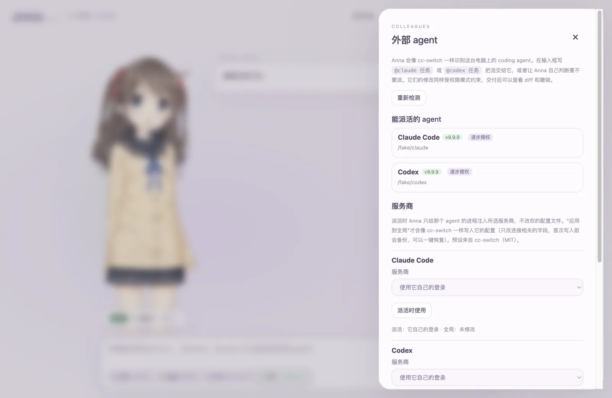

<div align="center">

# Anna

**她在你的桌面上醒来。**

陪你说话，替你做事，从不说谎。<br>
她是一个有自己的样子、性情和记忆的角色；会读代码、改文件、跑测试，<br>
遇到更合适的人选，就请 Claude Code 或 Codex 来帮忙。要你拍板的事，她会转过身来问你。

[](https://github.com/YuanyuanMa03/anna/actions/workflows/ci.yml)
[](https://github.com/YuanyuanMa03/anna/releases)
[](LICENSE)

[](https://github.com/YuanyuanMa03/anna/stargazers)

[English](README.md) · **简体中文** · [官网](https://anna.mayuanyuan.top) · [在线体验](https://modelscope.cn/studios/mayy101184/anna)


</div>

## v0.6.0 更新

Anna 现在有自己的本体和房间，也可以用人物图或 `.mavatar` 创造你的 Anna；外观变化不影响她的性格和记忆。新增一键选择大脑与 ACP 内核支持，并修复版本显示和长期记忆的来源记录。

## 认识 Anna

大多数 AI 工具，要么是一个聊天框，要么是终端里看不见的进程。Anna 两者都不是：她是住在你桌面上的角色，和你一起干活，不管换成哪个大脑，她始终是 Anna。

- ✿ **有自己的样子**：她的本体由原画做成，会看着你，你打字时低头听，摸摸头会害羞。思考、读文件、等你确认、完成任务，她都有不同的神态；换个权限模式，连站姿都会变。
- ♡ **有自己的性格**：善良、理性、真诚。她有自己的观点，也尊重你的最终决定；闲聊时简短温暖，做事时先说结论。
- ❋ **记得你**：长期记忆让她记住你的习惯和偏好。记了什么，你都能看到，也随时可以删掉。
- ✓ **对你真诚**：不编造工具结果，没跑过的测试就说没跑过；超出权限的事，一定先问你。

她有两种形态，本体和 Live2D 二次元形态，可以在“外观与能力”里切换。你也可以创造你自己的 Anna：在 更多 → 创造我的 Anna 里，给她一张人物图再点五下，或者给她一个做好的 `.mavatar`，她就变成那个样子，性格和记忆不变。

她的话浮在脸旁，说完会淡去；确认卡和交付卡从她手里递出来。不管是她自己把活交给 Claude Code 或 Codex，还是你用 `@claude`、`@codex` 派的活，结果都会回到她手里：她用自己的工具检查改动（有很快的测试也会跑），再告诉你能不能放心用。审阅一次 `@` 派的活要多花一轮模型调用，可以在“外观与能力”里关掉；大脑本身是 Claude Code 或 Codex 时不审阅。她的日记（长期记忆）和工作记录在换大脑后都还在。提到别的 agent 做的事，她会说明是谁做的，不抢功。

## 她能做什么

- 🧠 **真正的 agent 大脑**：基于 [pi coding agent](https://github.com/earendil-works/pi) SDK，有文件工具、终端、上下文压缩、自动重试和可续接的会话。大脑也可以换成 **Claude Code** 或 **Codex**，共同记忆、状态和派活这些自带工具通过本机的 MCP 服务一起带过去。
- 🤝 **会派活**：像 [cc-switch](https://github.com/farion1231/cc-switch) 一样识别你电脑上已装的 coding agent。输入 `@claude 修一下那个不稳定的测试`，Claude Code 就会开工，它的授权请求出现在 *Anna 的* 确认卡上。
- 🛡️ **Claude Code 式权限模式**：规划、谨慎、协作、放手，每种模式有自己的站姿。规则沿用 Claude Code 的格式和匹配方式（`Bash(pnpm test *)`、`Edit(src/**)`），Anna 自己的密钥和数据永远碰不到。
- 📦 **真正的系统沙箱**：终端命令通过 Anthropic 的 [sandbox-runtime](https://github.com/anthropics/sandbox-runtime) 运行在 Seatbelt（macOS）或 bubblewrap（Linux）里。只能写工作区，每个新域名都要你同意才能联网。
- ↩️ **改动可查看、可撤销**：每个任务结束都有交付卡，可以看 diff，也可以一键撤销。
- 🔀 **内置 cc-switch**：每个 agent（Claude Code、Codex、Gemini CLI）都有服务商页：来自 cc-switch 的 289 个预设（可搜索）或自己填；统一服务商（一个网关给三个 agent 用）；多地址测速；余额和 Coding Plan 额度；导入链接（cc-switch 格式）和导出 / 导入。选好的服务商用于派活和当大脑的 Claude Code / Codex，也可以写进 agent 自己的配置（先备份，可一键恢复）；在面板、托盘里切，或者直接让伙伴帮你切。Codex 用第三方模型时会带上模型目录，也可以直接用 DeepSeek（原生支持 Responses API）；只支持 Chat Completions 的服务商经 Anna 的本地路由接给 Claude Code 和 Codex，在本机转换格式，真实密钥只留在 Anna 里。给 Claude Code 或 Codex 设上备用服务商，正在用的出错时会自动换下一家，每家服务商都有熔断保护。打开“终端也走 Anna 的路由”，你在终端里直接运行的 Claude Code 或 Codex 也经过 Anna（Anna 退出时恢复原配置）。MCP 和 Skills 同步、用量统计在下一阶段。
- 💬 **微信远程派活**：通过微信 ClawBot 在手机上给 Anna 发任务，她会排队执行，做完后发回结果。授权仍然只在桌面端进行。

<table>
  <tr>
    <td width="33%"></td>
    <td width="33%"></td>
    <td width="33%"></td>
  </tr>
  <tr>
    <td align="center"><sub>督工 Claude Code</sub></td>
    <td align="center"><sub>交付卡：diff 与撤销</sub></td>
    <td align="center"><sub>识别到的 agent 与服务商</sub></td>
  </tr>
</table>

## 安装

> [!TIP]
> 想先见见她再决定装不装？[魔搭创空间](https://modelscope.cn/studios/mayy101184/anna)上有完整的 Anna 在线版，用免费模型：不用安装，不用填 API Key，每位访客都有自己独立的沙箱会话。

<p align="center"></p>

下载安装包，双击安装：

| 系统 | 安装包 | 第一次打开 |
|---|---|---|
| macOS（Apple 芯片） | [Anna-mac-arm64.dmg](https://github.com/YuanyuanMa03/anna/releases/latest/download/Anna-mac-arm64.dmg) | 把 Anna 拖进“应用程序”。如果提示“无法验证”，到 系统设置 → 隐私与安全性 点“仍要打开” |
| Windows 10 / 11 | [Anna-Setup-windows-x64.exe](https://github.com/YuanyuanMa03/anna/releases/latest/download/Anna-Setup-windows-x64.exe) | 如果出现“Windows 已保护你的电脑”，点“更多信息”→“仍要运行”。不需要管理员权限 |
| Ubuntu / Debian | [Anna-linux-amd64.deb](https://github.com/YuanyuanMa03/anna/releases/latest/download/Anna-linux-amd64.deb) | 双击用“软件”安装，或 `sudo apt install ./Anna-linux-amd64.deb` |

系统会提醒一次，是因为 Anna 没有经过 Apple 公证，Windows 版也没有代码签名证书（作者没有付费账号）。

习惯命令行的话，一行命令也能装，而且不会出现上面的提醒：

```bash
# macOS / Linux
curl -fsSL https://anna.mayuanyuan.top/install.sh | bash
```

```powershell
# Windows（PowerShell）
irm https://anna.mayuanyuan.top/install.ps1 | iex
```

安装脚本会下载最新版本、校验 SHA-256，然后完成安装。用 `curl` 或 PowerShell 下载的文件不带隔离标记，所以不会弹出 Gatekeeper 或 SmartScreen 的拦截。不管用哪种方式装，之后的更新都在应用内完成（`.deb` 装在系统目录里，更新时会打开下载页，下载新的安装包覆盖安装即可）。

Anna 没有经过 Apple 公证（作者没有付费开发者账号），但每个版本都用同一个自签名身份签名，所以升级后文件夹授权会保留。钥匙串更严格：没有 Apple 团队 ID 时，保存密钥的钥匙串条目只认每个版本的代码哈希，所以每次升级后新版本第一次读取密钥时，macOS 会请你输入一次登录密码。点“始终允许”后，这个版本就不会再问。安装脚本很短，可以[先读一遍](website/public/install.sh)再运行。

第一次启动时，在“模型与设置”里配置服务商：DeepSeek 开箱即用，任何兼容 OpenAI 或 Anthropic 协议的 HTTPS 端点也可以用。密钥由系统凭据库加密保存（Keychain、DPAPI 或 libsecret）。然后选择一个文件夹，告诉 Anna 你信任它，就可以派活了。按 <kbd>Shift</kbd>+<kbd>Tab</kbd> 切换权限模式。

## 权限模式

| | 规划 | 谨慎 | 协作 | 放手 |
|---|:---:|:---:|:---:|:---:|
| 读工作区 | ✅ | ✅ | ✅ | ✅ |
| 改工作区文件 | ❌ | 问 | ✅ | ✅ |
| 测试、lint、构建 | ❌ | 问 | ✅ | ✅ |
| 其他命令、联网 | ❌ | 问 | 问 | ✅ 在沙箱内 |
| 读工作区之外（包括 `~/.ssh`） | 问 | 问 | 问 | ✅ |
| 读密钥文件（`.env`、私钥），无论用工具、命令还是搜索 | 问 | 问 | 问 | 问 |
| 高风险命令、工作区外修改 | ❌ | 逐次问 | 逐次问 | 逐次问 |
| Anna 自己的密钥和数据 | ❌ | ❌ | ❌ | ❌ |
| 舞台表现 | 安静地看笔记 | 专注 | 中性 | 前倾、节奏快 |

确认卡有四个选项：**拒绝**、**仅允许一次**、**本次会话都允许**、**总是允许**。“总是允许”会把一条 Claude Code 格式的规则写进这个工作区。微信派来的任务始终按“谨慎”执行。详见 [docs/permissions.md](docs/permissions.md)。

## 其他 agent

| agent | 派活 | 当 Anna 的大脑 | 授权方式 | 状态 |
|---|:---:|:---:|---|---|
| Claude Code | ✅ | ✅ | 逐步授权（`--permission-prompt-tool stdio`） | 已在真机验证 |
| Codex | ✅ | ✅ | 逐步授权（`app-server` JSON-RPC） | 已在真机验证 |
| Gemini CLI | ✅ | ACP | 派活前确认一次 | 按协议实现 |
| OpenCode | ✅ | ACP | 派活前确认一次 | 按协议实现 |
| Pi | ✅ | | 派活前确认一次 | 按文档实现 |
| Claude Desktop、Grok Build、OpenClaw、Hermes、MiniMax Code | 识别 + 切换服务商 | | | |

说 ACP 的 agent 也可以当她的大脑，在她的沙箱里运行。这项默认关闭，因为还只跑过协议模拟，没跑过真实 agent；想试的话设置 `ANNA_ACP=1`（见 [docs/kernels.md](docs/kernels.md#acp-brains)）。

每次派活前，Anna 会给工作区拍一张快照，所以其他 agent 做的改动同样可以看 diff、可以撤销。协议细节和新增 agent 的方法见 [docs/kernels.md](docs/kernels.md)。

## 工作原理

- **所有大脑共用一个接口**：内核只需在每次调用工具前调用 `gate(tool, input)`，并发出统一格式的事件。权限、舞台、检查点和渠道都在 Host 里，对任何内核都一样。
- **agent 不会卡住窗口**：core 运行在独立进程里，崩溃后会自动重启，并从内核的 JSONL 日志恢复会话。
- **策略引擎是纯函数**：输入模式、规则、工作区和工具调用，输出允许、询问或拒绝。路径解析与 pi 完全一致，并会跟随符号链接。真正的安全边界是系统沙箱。

架构图和更多细节见 [docs/architecture.md](docs/architecture.md)。

## 开发

```bash
pnpm install --frozen-lockfile
pnpm assets          # 下载她的 Live2D 模型（不在 Git 里，见 NOTICE.md）
pnpm dev:desktop
```

只需要装 [pnpm](https://pnpm.io/zh/installation)，macOS、Windows、Linux，Intel 或 ARM 都一样。它会自动切换到锁定的 10.33.0，并下载锁定的 Node 24.21.0（和 Electron 44 内置的版本相同），所以每台电脑用的工具都一样。她的数据在 macOS 的 `~/Library/Application Support/Anna`、Windows 的 `%APPDATA%\Anna`、Linux 的 `$XDG_DATA_HOME/anna`。全新安装没有预设模型，从左上角的大脑入口选一个就行。

在中国大陆下载慢的话，先设置镜像再安装：

```bash
pnpm config set registry https://registry.npmmirror.com
```

```bash
pnpm config set node-mirror:release https://npmmirror.com/mirrors/node/
```

```bash
export ELECTRON_MIRROR=https://npmmirror.com/mirrors/electron/
```

```bash
pnpm lint && pnpm typecheck && pnpm test   # 单元测试、真实 pi 工具循环（faux 模型）、真实沙箱
pnpm build && pnpm test:scripted           # 桌面验收，使用脚本模型，不需要 API Key
pnpm package:mac                           # 或 package:windows / package:linux
```

CI 会在 macOS、Windows、Linux 上运行以上全部检查。想用你电脑上真实安装的 agent 测试，运行 `ANNA_REAL_AGENTS=claude,codex pnpm test tests/agents-real.test.ts`。

## 一路走来

Anna 换了三次大脑，她一直是 Anna。

1. **OpenClaw**：Anna 的第一个原型基于 [OpenClaw](https://github.com/openclaw/openclaw)。
2. **v0.2 · DeepSeek Harness**：搬进 Electron 桌面，用上真实的 Live2D 模型，由 DSH 驱动 agent 循环。
3. **v0.3 · pi**：DSH 撑不起真实的编程任务，于是大脑改用 pi coding agent SDK 重建。
4. **v0.4 · 任意大脑**：新增内核接口、Claude Code 式权限、系统沙箱，并且能把活派给你已经在用的 coding agent。

## 同类项目

Anna 站在三类项目的交汇处：Project AIRI 这样的 AI 伴侣，Clawd on Desk 这样盯着 coding agent 的桌宠，
以及 cc-switch、AionUi 这样的 coding agent 桌面工具。她强在哪里、还差在哪里、向谁学了什么，写在
[docs/comparison.zh-CN.md](docs/comparison.zh-CN.md)。

## 路线图

- [ ] 英文界面和人格
- [ ] 派活时使用独立的 Git worktree
- [ ] 在真机上验证 Gemini CLI、OpenCode、Pi 适配器
- [ ] 跨 agent 同步 MCP 和 skills；用量统计
- [x] Claude Code / Codex 当大脑时，也能使用 Anna 自己的工具（记忆、派活）
- [ ] Windows 上的命令沙箱
- [ ] 音素级口型同步

## 参与贡献

欢迎提 issue 和 PR，请先阅读 [CONTRIBUTING.md](CONTRIBUTING.md)。安全问题请按 [SECURITY.md](SECURITY.md) 私下报告。

Anna 由一个人开发。如果她帮到了你，想支持她继续长大，可以在[官网](https://anna.mayuanyuan.top)赞助。

## 致谢

[pi](https://github.com/earendil-works/pi)（agent 大脑）、[cc-switch](https://github.com/farion1231/cc-switch)（agent 识别与服务商预设）、[sandbox-runtime](https://github.com/anthropics/sandbox-runtime)（系统沙箱）、[Project AIRI](https://github.com/moeru-ai/airi)（Live2D 渲染方案）、[openclaw-weixin](https://github.com/Tencent/openclaw-weixin)（微信协议），以及 [Claude Code](https://github.com/anthropics/claude-code)（Anna 效仿的权限模型）。

## 许可证

Anna 源码公开，按 [PolyForm Noncommercial License 1.0.0](LICENSE) 个人和非商业用途可以免费使用。拿 Anna 去卖、在它的基础上做收费产品，或在公司内部使用，需要商业授权，详见 [COMMERCIAL.md](COMMERCIAL.md)（联系 yym290552@gmail.com）。v0.4.1 及以前的版本以 MIT 发布，这些版本仍然适用 MIT。

二次元形态用的 Live2D 样例角色（春）和 Cubism Core **不在** Anna 的许可证范围内：它们需要单独下载，并遵循 Live2D 自己的条款，详见 [NOTICE.md](NOTICE.md)。
